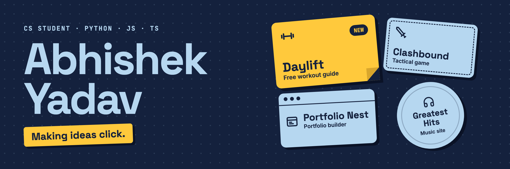

<strong>Second-year Computer Science student at the University of Greenwich</strong> Python · JavaScript · TypeScript

I build web apps people can use straight away: an offline gym workout app, a two-player browser game and a portfolio builder. I test my code and write down why I built things the way I did.

**Hiring, or have a project in mind?** I'm open to software development roles and collaborations. Send me a message and I'll reply.

### How I work

- **Tested:** Daylift runs its Vitest suite before every deploy, and Clashbound has a pytest suite.
- **Documented:** Daylift has a written [product spec](https://github.com/Abijeason/daylift/blob/main/docs/PRD.md), [architecture](https://github.com/Abijeason/daylift/blob/main/docs/ARCHITECTURE.md), [security notes](https://github.com/Abijeason/daylift/blob/main/docs/SECURITY.md) and [testing approach](https://github.com/Abijeason/daylift/blob/main/docs/TESTING.md).
- **Collaborative:** Clashbound is built with a teammate through reviewed pull requests, such as my [battle engine](https://github.com/Zain-ux-lab/Clashbound/pull/3).

### Pick a project. Take it for a spin.

**🏋️ Daylift** · New · live on GitHub Pages  
A free gym workout guide that installs like an app and works offline. It builds a weekly plan around your goal, experience and gym equipment, then guides each workout set by set. Friends can share one plan, and each phone sets its own sets, reps and weights. I built it in React and TypeScript, with no account and workout history kept on the phone.  
**[Try it](https://abijeason.github.io/daylift/)** · [Source](https://github.com/Abijeason/daylift)

**⚔️ Clashbound** · V1 live on Render · V2 in development  
A two-person tactical browser game: choose three fighters, customise their moves, and battle a bot. My work spans core combat logic, artwork, music, menus and the homepage/battle interface, with tests and security checks.  
**[Play V1](https://clashbound.onrender.com/)** · [Source](https://github.com/Zain-ux-lab/Clashbound)

**📄 Portfolio Nest**  
Build a portfolio with projects, photos and videos, then download it as one self-contained HTML file. I worked on the builder, browser draft saving, media previews and export so recipients can view the work without an account.  
**[Build yours](https://abijeason.github.io/portfolio-nest/)** · [Source](https://github.com/Abijeason/portfolio-nest)

**🎵 Greatest Hits Central**  
A responsive music discovery website with artist pages and interactive navigation. I built its HTML/CSS layouts and JavaScript interactions to make browsing music straightforward across screen sizes.  
**[Explore the site](https://abijeason.github.io/greatest-hits-central/)** · [Source](https://github.com/Abijeason/greatest-hits-central)

<strong>🔎 Behind the builds: explore my contributions</strong>

**Daylift:** read the [data model](https://github.com/Abijeason/daylift/blob/main/docs/DATA-MODEL.md) and the full [document list](https://github.com/Abijeason/daylift#documents).

**Clashbound:** see my [battle engine](https://github.com/Zain-ux-lab/Clashbound/pull/3), [homepage & battle UI](https://github.com/Zain-ux-lab/Clashbound/pull/23), and [session-cookie fix](https://github.com/Zain-ux-lab/Clashbound/pull/19).

Clashbound was built with my teammate using AI assistance, peer review, automated tests and playtesting. V2 is still in development. The Render demo may take a moment to wake up.

**What I’m practising:** state management, readable interfaces, testing edge cases, and collaborating through pull requests.

---

<strong>🛠 Python · JavaScript · TypeScript · React · HTML · CSS · FastAPI · pytest · GitHub Actions</strong> <em>Like what you see? <a href="https://www.linkedin.com/in/abhishek-yv/">Let's talk on LinkedIn</a>.</em>

