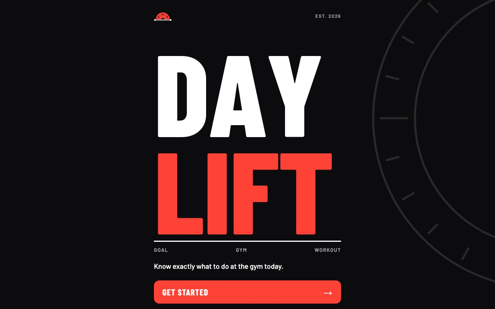
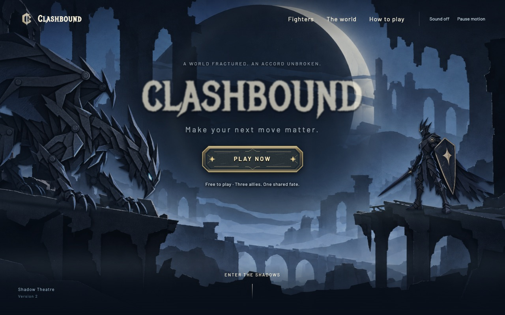
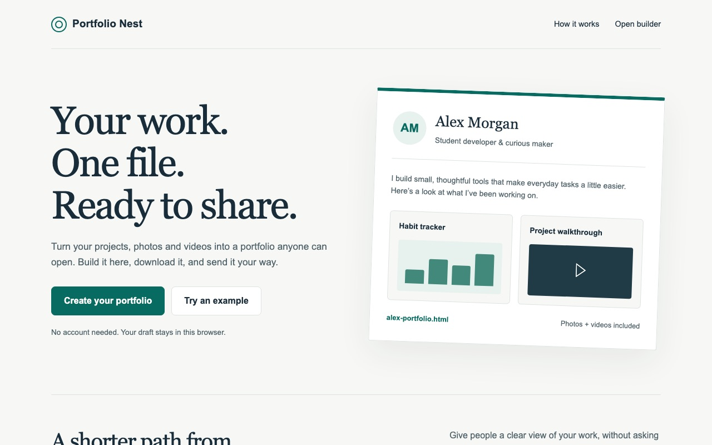
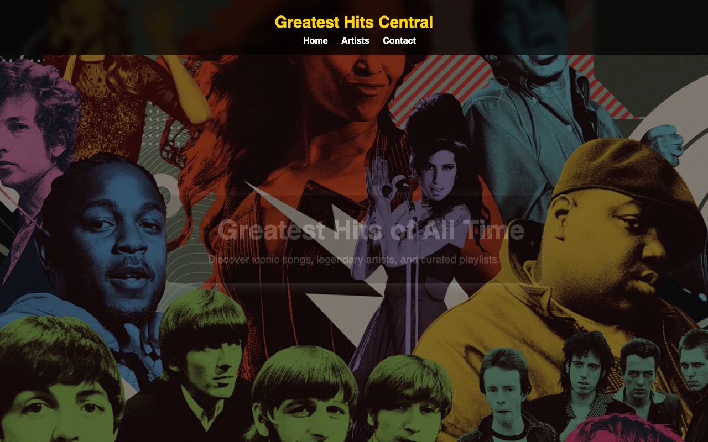

### Second-year Computer Science student at the University of Greenwich

I build web apps people can use straight away, then test and document them so someone else could pick them up tomorrow.

 

## Featured: Daylift

<table>
<tr>
<td width="52%" valign="top">

</td>
<td valign="top">

**A free gym workout guide that tells you exactly what to do today.**

- Builds a weekly plan around your goal, experience and the equipment your gym has
- Guides each workout set by set, with suggested weights and a rest timer
- Friends share one plan, and each phone sets its own sets, reps and weights
- Works offline, needs no account and keeps workout history on the phone

`React` `TypeScript` `Vite` `Vitest` `PWA`

**[Try it](https://abijeason.github.io/daylift/)** · [Source](https://github.com/Abijeason/daylift) · [Design docs](https://github.com/Abijeason/daylift#documents)

</td>
</tr>
</table>

## More projects

<table>
<tr>
<td width="33%" valign="top">

**Clashbound** 
A two-player tactical browser game. Pick three fighters, customise their moves and battle a bot.

*My part:* combat logic, artwork, music, menus and the battle interface.

[Play](https://clashbound.onrender.com/) · [Source](https://github.com/Zain-ux-lab/Clashbound)
</td>
<td width="33%" valign="top">

**Portfolio Nest** 
Build a portfolio with projects, photos and videos, then download it as one HTML file anyone can open.

*My part:* the builder, draft saving, media previews and export.

[Build yours](https://abijeason.github.io/portfolio-nest/) · [Source](https://github.com/Abijeason/portfolio-nest)
</td>
<td width="33%" valign="top">

**Greatest Hits Central** 
A responsive music discovery site with artist pages and interactive navigation.

*My part:* the HTML and CSS layouts and the JavaScript interactions.

[Explore](https://abijeason.github.io/greatest-hits-central/) · [Source](https://github.com/Abijeason/greatest-hits-central)
</td>
</tr>
</table>

## How I work

<table>
<tr>
<td width="33%" valign="top">

**Tested** 
Daylift runs its Vitest suite before every deploy. Clashbound has a pytest suite.

</td>
<td width="33%" valign="top">

**Documented** 
Daylift has a written [product spec](https://github.com/Abijeason/daylift/blob/main/docs/PRD.md), [architecture](https://github.com/Abijeason/daylift/blob/main/docs/ARCHITECTURE.md), [security notes](https://github.com/Abijeason/daylift/blob/main/docs/SECURITY.md) and [testing plan](https://github.com/Abijeason/daylift/blob/main/docs/TESTING.md).

</td>
<td width="33%" valign="top">

**Collaborative** 
Clashbound is built with a teammate through reviewed pull requests, such as my [battle engine](https://github.com/Zain-ux-lab/Clashbound/pull/3).

</td>
</tr>
</table>

<strong>Behind the builds</strong>

 

**Clashbound:** see my [battle engine](https://github.com/Zain-ux-lab/Clashbound/pull/3), [homepage and battle UI](https://github.com/Zain-ux-lab/Clashbound/pull/23) and [session-cookie fix](https://github.com/Zain-ux-lab/Clashbound/pull/19). It was built with my teammate using AI assistance, peer review, automated tests and playtesting. The Render demo may take a moment to wake up.

**Daylift:** read the [data model](https://github.com/Abijeason/daylift/blob/main/docs/DATA-MODEL.md) and the full [document list](https://github.com/Abijeason/daylift#documents).

**What I'm practising:** state management, readable interfaces, testing edge cases and collaborating through pull requests.

## Toolkit

---

**Hiring, or have a project in mind?** I'm open to software development roles and collaborations. 
Send me an email at [yadavabhishek4751@gmail.com](mailto:yadavabhishek4751@gmail.com) and I'll reply.

