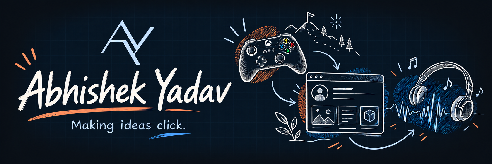

<strong>CS student</strong> Python, JavaScript, and ideas worth building.

### Pick a project. Take it for a spin.

**⚔️ Clashbound** · V1 live on Render · V2 in development  
A two-person tactical browser game: choose three fighters, customise their moves, and battle a bot. My work spans core combat logic, artwork, music, menus and the homepage/battle interface, with tests and security checks.  
**[Play V1](https://clashbound.onrender.com/)** · [Source](https://github.com/Zain-ux-lab/Clashbound)

**🪺 Portfolio Nest**  
Build a portfolio with projects, photos and videos, then download it as one self-contained HTML file. I worked on the builder, browser draft saving, media previews and export so recipients can view the work without an account.  
**[Build yours](https://abijeason.github.io/portfolio-nest/)** · [Source](https://github.com/Abijeason/portfolio-nest)

**🎵 Greatest Hits Central**  
A responsive music discovery website with artist pages and interactive navigation. I built its HTML/CSS layouts and JavaScript interactions to make browsing music straightforward across screen sizes.  
**[Explore the site](https://abijeason.github.io/greatest-hits-central/)** · [Source](https://github.com/Abijeason/greatest-hits-central)

<strong>🔎 Behind the builds: explore my contributions</strong>

**Clashbound:** see my [battle engine](https://github.com/Zain-ux-lab/Clashbound/pull/3), [homepage & battle UI](https://github.com/Zain-ux-lab/Clashbound/pull/23), and [session-cookie fix](https://github.com/Zain-ux-lab/Clashbound/pull/19).

Built with my teammate using AI assistance, peer review, automated tests and playtesting. V2 is still in development. The Render demo may take a moment to wake up.

**What I’m practising:** state management, readable interfaces, testing edge cases, and collaborating through pull requests.

---

<strong>🛠 Python · JavaScript · HTML · CSS · FastAPI · pytest · GitHub Actions</strong> <em>Still exploring. Always building. Happy to team up.</em>

